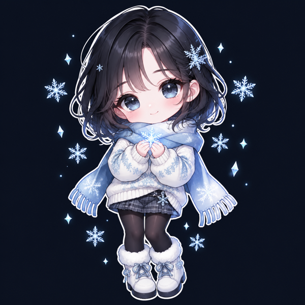

<!-- ❄️ WINTER // FROZEN PROFILE ❄️ -->

<div align="center">




</div>

---

## 🌨️ About Me

```dart
class Winter extends Developer {
  final String location   = 'Vietnam 🇻🇳';
  final List<String> code = ['Flutter', 'Swift', 'TypeScript'];
  final String currently  = 'Native macOS + mobile apps';
  final String vibe       = 'aespa Winter ❄️';
}
```

---

## 🧊 Frozen Projects

<table>
<tr>
<td width="50%" valign="top">

### 🖼️ [WinterShot](https://github.com/winterzxzz/winter_shot)
Free open-source **macOS screenshot & screen recording** app — freeze-frame capture, 9 annotation tools, background beautify, OCR, and a Screen Studio-style editor with click-to-zoom. 100% on-device.

 `Swift` · `SwiftUI` · [🌐 site](https://winterzxzz.github.io/winter_shot/)

</td>
<td width="50%" valign="top">

### 🎙️ [WinterVoice](https://github.com/winterzxzz/winter_voice)
Free open-source **dictation app for macOS** — speak your prompts into Claude Code, Cursor or any app. Private on-device Whisper, 90+ languages.

 `Swift` · `Whisper` · [⬇️ download](https://github.com/winterzxzz/winter_voice/releases/latest)

</td>
</tr>
<tr>
<td width="50%" valign="top">

### 💎 [liquid_glass_native](https://github.com/winterzxzz/flutter_native_view)
**Liquid Glass widgets** for Flutter, backed by native SwiftUI on iOS 26+.

 `Flutter` · `Swift` · [📦 pub.dev](https://pub.dev/packages/liquid_glass_native)

</td>
<td width="50%" valign="top">

### 🔔 [app_update_check](https://github.com/winterzxzz/app_update_check)
Flutter plugin — check App Store / Google Play for a newer version, optional or forced update dialog, TestFlight detection. Zero dependencies.

 `Flutter` · `Dart` · [📦 pub.dev](https://pub.dev/packages/app_update_check)

</td>
</tr>
</table>

<div align="center">
  <a href="https://github.com/winterzxzz?tab=repositories">
    
  </a>
</div>

---

## ❄️ Tech Stack

<div align="center">


</div>

---

## 🤝 Connect

<div align="center">

<a href="https://www.linkedin.com/in/winter7123/"></a>

<br/><br/>


</div>
